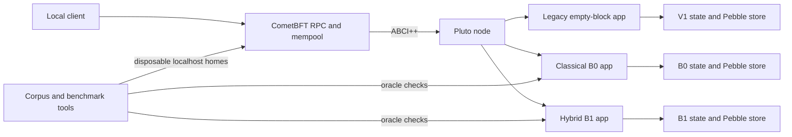

# Pluto architecture

This document describes the current source tree. B0 and B1 are protocol
profiles with distinct wire formats, genesis records, state commitments and
database formats. Their names remain in protocol identifiers and in import
aliases where code uses both profiles. Historical implementation reports
remain under `research/`.

## Components

| Location | Responsibility |
| --- | --- |
| `cmd/plutod` | CLI for initialization, running a node, and inspecting legacy state |
| `internal/node` | Profile selection, home validation, CometBFT process and ABCI server lifecycle |
| `internal/legacy` | Original transaction-free application and V1 persistent state |
| `internal/classical/tx` | Canonical B0 transaction encoding and secp256k1 authentication |
| `internal/classical/genesis` | B0 Genesis V2 transport |
| `internal/classical/state` | B0 balances, nonces, transitions and AppHash V2 |
| `internal/classical/store` | Durable B0 snapshot and recovery checks |
| `internal/classical/app` | B0 ABCI++ callbacks and account queries |
| `internal/hybrid/tx` | Canonical B1 transaction and both signature checks |
| `internal/hybrid/genesis` | B1 Genesis V3 transport |
| `internal/hybrid/state` | B1 key registry, B0-compatible transfer rules and AppHash |
| `internal/hybrid/store` | Durable B1 snapshot and recovery checks |
| `internal/hybrid/app` | B1 ABCI++ callbacks and account queries |
| `internal/hybrid/testutil` | Public test fixture construction; not used by the live node |
| `internal/experiment` | Public corpus, correctness oracle and cost measurements |
| `cmd/corpus`, `research/benchmarks` | Corpus CLI, bounded runners and analyzers |
| `test/integration` | Real localhost node and validator process tests |

The application packages depend on their profile's transaction, genesis,
state and store packages. The hybrid state package uses the accepted B0
transfer primitives after authenticating both signatures against the genesis
key registry. `internal/node` owns lifecycle orchestration; application
packages do not start CometBFT. Experiment code imports profile code, while
the live node does not import experiment code.

## Transaction and state flow

1. `CheckTx` reads only committed state and can reject a locally submitted
   transaction before it reaches the mempool.
2. `PrepareProposal` and `ProcessProposal` validate the ordered candidate
   transactions independently of any local `CheckTx` result.
3. `FinalizeBlock` computes a pending candidate and AppHash without writing
   it as committed state.
4. `Commit` performs the synchronized persistent write. On restart, `Info`
   reports the last durable height and AppHash to CometBFT for replay checks.

The legacy profile rejects all transactions. The classical profile requires
secp256k1 authentication. The hybrid profile requires secp256k1 and
ML-DSA-44 over the same canonical intent, bound to registered keys. The
profiles have separate on-disk records and reject mismatched homes.

## Data and research boundaries

CometBFT v0.38.26 owns consensus, P2P, block coordination and its mempool.
Pluto owns application validity, accounts, state persistence and AppHash.
The node defaults to localhost listeners. Tests and benchmark runners create
isolated homes and stop their own child processes. Public corpora and reviewed
summary tables are versioned; generated keys, homes, process logs and raw
results stay local. The dated specifications, decisions and reports under
`research/` record how these components were established and their limits.
