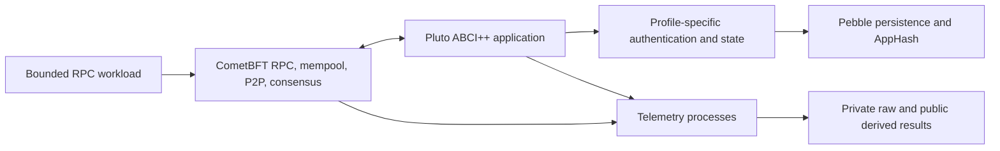

# Beam / Pluto

Beam is a Go research repository for a CometBFT v0.38.26 blockchain and controlled transaction experiments. The node CLI and Go module retain the name **Pluto** (`example.com/pluto`). CometBFT supplies consensus, P2P and the mempool; a custom ABCI++ application supplies transaction validity, account state, durable storage and AppHash. There is no EVM or ML detector.

## Research objective

The study compares classical secp256k1 and hybrid secp256k1–ML-DSA-44 verification cost, then measures whether bounded invalid hybrid traffic changes service for a fixed stream of valid transactions. C, CP, P and H are controlled experimental profiles. CP matches H's 2,568-byte wire size while retaining classical verification.



The selectable node modes are a transaction-free compatibility mode, classical B0 and hybrid B1. The C/CP/P/H comparison runs in the isolated research harness and is not a `plutod` mode. Four validators provide a real CometBFT consensus path; the published experiments place them on **one physical host** and submit through validator-0 loopback RPC. See [architecture](docs/ARCHITECTURE.md), [design rationale](docs/DESIGN_RATIONALE.md), [transaction flow](docs/TRANSACTION_FLOW.md) and [authentication profiles](docs/AUTHENTICATION_PROFILES.md).

## Repository map

| Path | Responsibility |
| --- | --- |
| `cmd/plutod`, `internal/node`, `internal/{legacy,classical,hybrid}` | CLI, node lifecycle and the three compatible blockchain applications. |
| `internal/experiment/{profiles,load,telemetry,corpus,benchmark}` and `cmd/research/` | Controlled profile implementation, bounded generator, observers, corpus and benchmark executables. |
| `configs/experiments`, `experiments/scenarios/corpus`, `experiments/analysis` | Validated safety/factor configuration, public scenarios, runners, analyzers and verifiers. Case IDs remain where source-locked reproducibility requires them. |
| `tests/`, `docs/`, `results/` | Integration/fixture tests, system and scientific method documentation, final findings and provenance index. |
| `research/protocol`, `research/evidence`, ignored `research/artifacts` | Accepted locked study contracts, case-level evidence and private immutable run output. These are scientific provenance, not project progress records. |

## Requirements and installation

Linux or WSL2, Go 1.24.x, Python 3 and GNU Make are required. Initial dependency download needs network access. Python's `matplotlib` is needed only to regenerate PNG figures; the independent B0 vector oracles also need `cryptography`.

```bash
go mod download
make build
```

## Quick start

```bash
./build/plutod init --home .pluto --chain-id pluto-dev-1
./build/plutod start --home .pluto
```

The node binds RPC, P2P and ABCI to localhost by default. `init` refuses an existing home; generated validator keys and node homes stay private. For B0/B1 setup, restarts, RPC inspection and bounded experiments, follow [REPRODUCE.md](REPRODUCE.md). `make verify` checks build, Go tests, vet, formatting, module integrity, public artifact hashes and the CLI version. `make test-file02-common` checks experimental schemas and analyzers.

## Experiments and reproduction

`make test-s07-smoke` runs a bounded four-profile QA session on fresh local networks; it does not create a new published estimate. The accepted case plans, public corpora, analyzers and integrity checks are described in [REPRODUCE.md](REPRODUCE.md). Historical case results require their locked source revision and private raw session for full rederivation.

## Findings and limits

At matched 20 valid tx/s, accepted RQ1 measured **H−CP application CheckTx +81.47 µs/tx** (paired 95% CI [+75.16,+87.26]). In the prospective L/B/I service study, the I−B first-all-four block-observation upper-bound difference was **+60.03 ms** ([+39.51,+81.54] ms); every fixed valid H was observed within the historical 3-second endpoint. No sustained degradation event or capacity knee was established at tested rates through 25 tx/s. These results support a bounded mechanism and service report, not a DoS or distributed-network conclusion. RQ2 early degradation is NOT ESTABLISHED and RQ3 ML benefit is NOT_RUN. See [resource cost](results/RESOURCE_COST.md), [service impact](results/SERVICE_IMPACT.md), [limitations](results/LIMITATIONS.md) and [methodology](docs/EXPERIMENT_METHODOLOGY.md).
