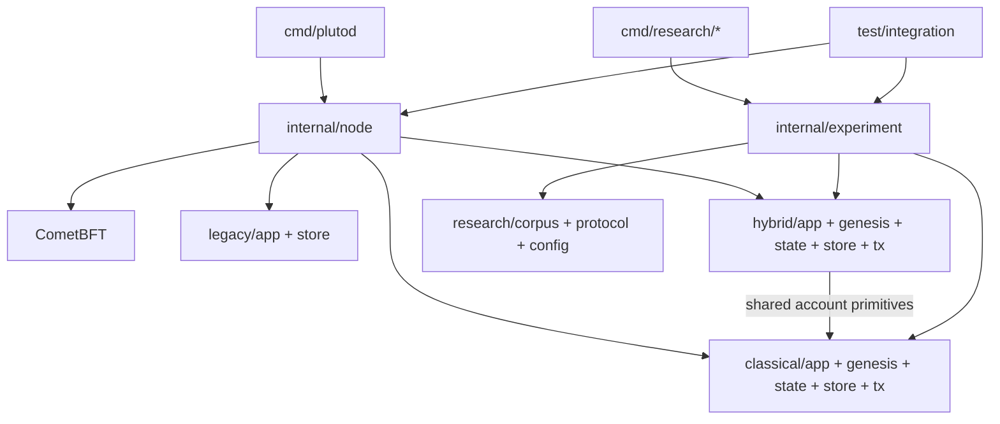

# Pluto source architecture

Pluto is a Go ABCI++ application connected to pinned CometBFT v0.38.26. CometBFT owns validator consensus, P2P, block coordination and its mempool. Pluto owns transaction decoding, authentication, account transitions, persistent state and AppHash. There is no EVM, admission optimization or ML detection implementation.

`internal/legacy` is the Phase 02 empty-block chain with its original V1 state. `internal/classical` is the accepted B0 protocol: canonical secp256k1 transaction, B0 genesis, account transition, Pebble store and ABCI++ adapter. `internal/hybrid` is the separate B1 protocol: secp256k1 and ML-DSA-44 authenticate one intent against genesis-bound keys; its state uses accepted classical account primitives but has its own wire, registry, record and AppHash. These are selectable `plutod` modes through `internal/node`.

`internal/experiment/profiles` implements the controlled C/CP/P/H comparison using one profile-selected transaction/state path, its own genesis, store and ABCI application. It is wired by the integration harness, not selected by the normal `plutod` CLI. `internal/experiment/load` holds the bounded S06 plan, generator and guard. `telemetry` holds S05 recorder, collector and ingress observation; only the controlled-profile app imports it for optional CheckTx observation. `corpus/profiles` and `corpus/b0b1` are separate public inputs and oracles. `benchmark` contains historical B0/B1 measurement primitives. No historical B0/B1 application imports experimental code.

The dependency edges follow source imports. The deliberately shared edge from B1 and controlled profiles to classical state is limited to account primitives. Retaining the old Go package identifiers (for example `b0state`, `b1tx`, `researchv2`) avoids changing references and keeps protocol identity explicit while directories express responsibility. `internal/version` supplies build metadata only.

`research/` is the sole research tree: `protocol/` states contracts, `config/` pins runs, `corpus/` holds public data, `benchmarks/` has runners and analyzers, `checklists/` tracks gates, `tools/` holds preparation scripts, `evidence/` retains records, and ignored `artifacts/` holds private or raw output. Historical specifications and reports retain their original names and bytes. See [mapping](REFACTOR_MAPPING.md) for every moved package and executable.
