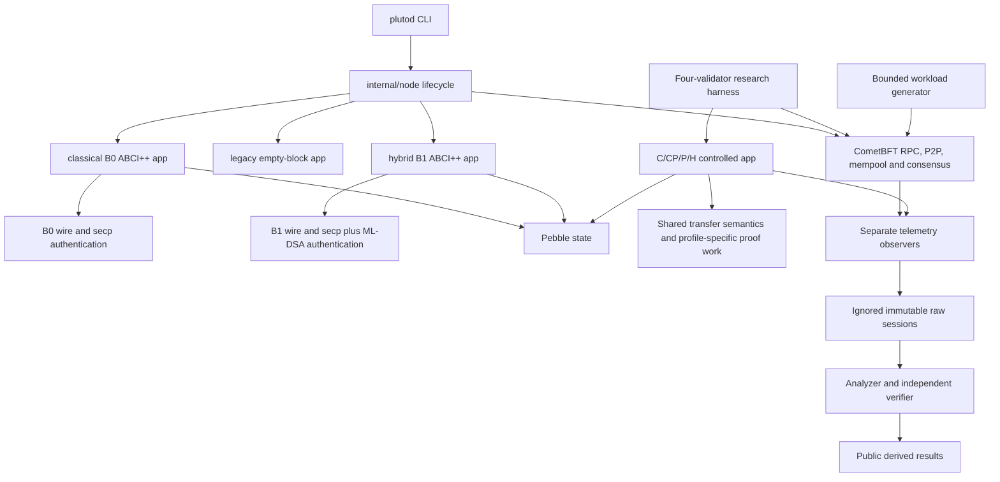

# System architecture

Beam contains the Pluto blockchain application and a separate measurement system. The Go module is `example.com/pluto`. `go.mod` pins CometBFT v0.38.26, Pebble v1.1.5, Cloudflare CIRCL v1.6.4 for ML-DSA-44 and secp256k1/v4 v4.4.1. No Cosmos SDK, EVM or detector is present.

## Boundaries

| Component | Owns | Source |
| --- | --- | --- |
| CometBFT | Validator voting, peer transport, block coordination, transaction mempool, RPC and native precheck. | Pinned external module and disposable source-checked telemetry overlay. |
| Pluto ABCI++ application | Canonical transaction decoding, authentication, account and nonce rules, CheckTx result, proposal validation, pending state, durable Commit and AppHash. | `internal/{legacy,classical,hybrid}`; controlled research app in `internal/experiment/profiles`. |
| Node lifecycle | Local home creation, profile selection, Comet configuration, process startup and restart consistency. | `cmd/plutod`, `internal/node`. |
| Experiment system | Pre-signed scenario construction, safety caps, open-loop sends, independent oracle, telemetry, QC, statistics and integrity. | `cmd/research`, `internal/experiment`, `experiments`, `configs/experiments`, `tests/integration`. |

`plutod init` selects the transaction-free compatibility application. `init-b0` initializes classical B0; `init-b0-4v` and `init-b1-4v` initialize controlled four-validator B0 and B1 networks. C/CP/P/H use their own common application through the research harness. The compatibility application remains because node regression tests require its persisted V1 behavior; it is not an interchangeable implementation of B0 or B1. B1 and the controlled profiles reuse classical account primitives but retain distinct transaction formats, registries, validation rules and AppHash domains.

## Transaction and measurement flow

A client submits canonical signed bytes to Comet RPC in the published experiments. Comet precheck and cache may reject before `CheckTx`; successful `CheckTx` admits the transaction to the Comet mempool. Comet can relay accepted transactions to peers and propose them. `PrepareProposal` and `ProcessProposal` validate proposal bytes independently of local mempool admission. `FinalizeBlock` computes pending state; `Commit` performs the synced Pebble write. Same-height state and AppHash across four validators are checked by the oracle. See [transaction flow](TRANSACTION_FLOW.md).

The generator records offered send offsets and actual sends. Optional app instrumentation records rejection stage and CheckTx wall spans; separate processes observe Comet counters and process CPU/RSS. The bounded X07 overlay records selected ABCI and P2P queue path timestamps. Raw sessions under ignored `research/artifacts/` are write-once and hashed; case verifiers recompute per-run and aggregate outputs. Public aggregates and source/raw hashes remain under `research/evidence/file02/`; final scientific synthesis is in `results/`. [Metrics](METRICS.md) states what each observation means.

## Deployment and validity

The result-producing topology used four Comet processes and, in later runs, four dedicated ABCI app processes **on one physical Linux host**. Submission was validator-0 loopback RPC. A four-validator consensus path is real, but host, disk, scheduler and physical network resources are shared. A 100-ms block scanner yields a first-all-four observation **upper bound**, not exact commit time. P2P-origin injection, independent physical-host performance, cross-host clock precision, EVM behavior and sustained production capacity were not measured. Safety controls cap offered rate at 25 tx/s, encoded bytes at 65,536 B/s, outstanding requests at 16 and run duration at 60 s for the applicable File 02 workload.
