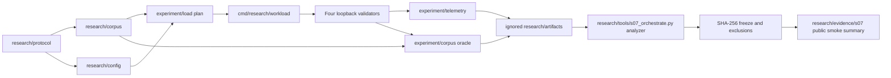

# Experiment flow

The S03 controlled profiles C, CP, P and H share one transaction and state path while varying proof requirements and controlled padding. S04 adds a public correctness corpus and a real four-validator localhost harness in `test/integration`. S05 adds optional CheckTx recording, an RPC ingress proxy and separate observer processes; a source-checked CometBFT overlay supplies specific P2P ingress and socket-queue metrics. Missing capture points remain `NOT MEASURED` in the [metric dictionary](../research/protocol/METRICS_DICTIONARY.md).

S06 pins a [testbed configuration](../research/protocol/TESTBED_CONFIG.md), validates a pre-signed capability-correct plan and sends at absolute deadlines. `internal/experiment/load` records planned and actual socket-write times, `RATE_MISS` and `SAFETY_ABORT`. It only submits to controlled loopback RPC; P2P relay is observed separately. The guard watches four observer streams, status and divergence. The integration pilot uses four validators on one host, which is not independent infrastructure.

S07 adds the [orchestrator](../research/tools/s07_orchestrate.py) and
[reproduction guide](../REPRODUCE.md). It starts four fresh C/CP/P/H networks,
uses a small benign/invalid workload, verifies same-height block/state and
CheckTx outcomes, collects four telemetry streams, derives one row per run,
records invalid-run exclusions and freezes private raw/derived files by
SHA-256. [The public example](../research/evidence/s07/smoke_sample.json)
contains only sanitized smoke metrics and hashes. Four validators on one host
do not give independent network infrastructure.

RQ1 resource impact has the controlled profiles, offered-load plans and
telemetry needed for future measurement. RQ2 detectability has labeled
scenarios and timestamped feature sources, but no detector, calibration or
held-out alert evaluation. RQ3 baseline gap has no trained ML model or
comparison with simple detection baselines. S04's correctness oracle supports
the quality gate for all three RQs; it is not an RQ2 result. Confirmatory
RQ1–RQ3 experiments, multi-host independence, full DoS workloads and ML
detection are not implemented or claimed. Historical Phase 05 results remain
separate from the S03–S07 research program. Public corpus and frozen evidence
stay under `research/`; private plans, homes and raw logs stay in ignored
`research/artifacts/`.
