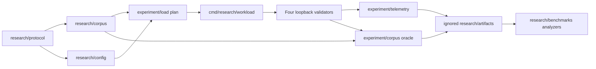

# Experiment flow

The S03 controlled profiles C, CP, P and H share one transaction and state path while varying proof requirements and controlled padding. S04 adds a public correctness corpus and a real four-validator localhost harness in `test/integration`. S05 adds optional CheckTx recording, an RPC ingress proxy and separate observer processes; a source-checked CometBFT overlay supplies specific P2P ingress and socket-queue metrics. Missing capture points remain `NOT MEASURED` in the [metric dictionary](../research/protocol/METRICS_DICTIONARY.md).

S06 pins a [testbed configuration](../research/protocol/TESTBED_CONFIG.md), validates a pre-signed capability-correct plan and sends at absolute deadlines. `internal/experiment/load` records planned and actual socket-write times, `RATE_MISS` and `SAFETY_ABORT`. It only submits to controlled loopback RPC; P2P relay is observed separately. The guard watches four observer streams, status and divergence. The integration pilot uses four validators on one host, which is not independent infrastructure.

RQ1 resource cost is supported by B0/B1 historical benchmark primitives, C/CP/P/H profiles, offered-load plans and telemetry. RQ2 processing correctness is supported by public corpus, direct ABCI oracle, replay and four-validator assertions. RQ3 invalid workload resilience is supported by capability-labeled scenarios and safety aborts. Confirmatory loaded RQ1–RQ3 experiments, multi-host independence, full DoS workloads and ML detection are not implemented or claimed. Historical Phase 05 results remain separate from the S03–S06 research program. Public corpus and frozen evidence stay under `research/`; private plans, homes and raw logs stay in ignored `research/artifacts/`.
