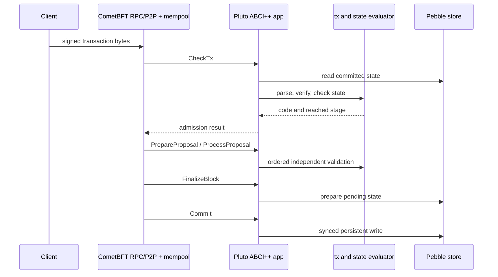

# Transaction flow

Client submission may enter CometBFT through RPC or P2P. CometBFT owns its mempool, peer relay, validator voting and block order. Pluto owns `CheckTx` admission codes and the separate proposal checks. A local `CheckTx` success does not make a proposal valid: `PrepareProposal` filters candidate transactions and `ProcessProposal` validates ordered bytes again, including bytes that bypassed a local mempool. `FinalizeBlock` computes a pending result; `Commit` performs the synced durable write. AppHash derives from the selected application's committed state, not an Ethereum state root.

The selected `internal/classical/tx`, `internal/hybrid/tx` or `internal/experiment/profiles/tx.go` parser owns canonical bytes and intent. Its matching state evaluator owns signature order, key binding, nonce and balance checks. The matching app maps results to ABCI codes and rejects an invalid proposal or state; its store owns persistence. The legacy application rejects transactions. Hybrid requires both secp256k1 and ML-DSA-44 checks against the same intent. Controlled C/CP/P/H select proofs according to the experimental profile; they are not aliases for B0/B1.

Read the accepted [`B0 ABCI validity specification`](../research/specs/B0_ABCI_VALIDITY_SPEC_V1.md), [`B1 authentication specification`](../research/specs/B1_HYBRID_AUTHENTICATION.md), and [`profile equivalence report`](../research/protocol/PROFILE_EQUIVALENCE.md) for exact rules and test vectors.
