# S01 transaction pipeline map

Source: `origin/test-mainet` commit `0bdd869f2c6b3ed59b0ae825954d8667b3c7481e`, tree `09c24280590aee51d97b53b18c5d9e193dbe6dbe`. CometBFT is pinned to v0.38.26 in `go.mod`. The paths below describe the flood/CList mempool used by the local B0/B1 nodes; they are not throughput measurements.

```mermaid
flowchart LR
  RPC[RPC broadcast_tx_*] --> Admission[Comet CListMempool.CheckTx]
  Peer[P2P mempool Reactor.Receive] --> Admission
  Admission --> Pre[full/size/preCheck/app-connection checks]
  Pre --> Cache[Comet tx cache Push/dedup]
  Cache --> ABCI[Pluto ABCI CheckTx]
  ABCI --> Auth[B0 secp or B1 key binding → secp → ML]
  Auth --> State[nonce/balance check]
  State -->|Code OK and postCheck OK| Pool[accepted mempool]
  State -->|invalid| Reject[reject; cache removal depends on config]
  Pool --> Relay[P2P broadcastTxRoutine]
  Pool --> Prepare[PrepareProposal]
  Prepare --> Process[ProcessProposal independently evaluates candidate]
  Process --> Finalize[FinalizeBlock pending result]
  Finalize --> Commit[Commit sync persistence]
  Commit --> Update[Comet mempool Update/recheck remaining txs]
  Update --> ABCI
```

| Boundary | Exact source | Reject/cache/recheck behavior |
|---|---|---|
| RPC | Comet `rpc/core/mempool.go` `BroadcastTxAsync`, `BroadcastTxSync`, `BroadcastTxCommit` | Each calls mempool `CheckTx`; sync waits for admission response, commit waits for block inclusion as well. These endpoint latencies are different quantities. |
| P2P ingress | Comet `mempool/reactor.go:150` `Receive` | Calls the same mempool `CheckTx` with peer sender metadata. |
| Precheck/cache | Comet `mempool/clist_mempool.go:223` `CheckTx` | Checks full pool, max transaction size, optional precheck, app connection, then tx cache. A duplicate stops at cache before Pluto crypto. Default flood mempool: recheck and broadcast on, 5,000 accepted tx, 1 GiB total bytes, 10,000 cache entries, 1 MiB per tx (`config/config.go:795`). |
| Application CheckTx | `internal/b0app/app.go:181`, `internal/b1app/app.go:137` | B0 calls `b0state.EvaluateTrusted`; B1 calls `b1state.EvaluateTrusted`. Both read committed state, so CheckTx alone does not commit. |
| Crypto and state | `internal/b0state/transition.go:30`; `internal/b1state/state.go:272`; `internal/b1tx/tx.go:191,207` | B0 validates canonical wire and secp proof, then state. B1 checks structure/chain/amount, both key encodings and registered binding, secp proof, ML proof, then account state. Early failures do not reach later verification. |
| Accepted pool | Comet `mempool/clist_mempool.go:401` `resCbFirstTime` | Adds only `Code == 0` and successful postcheck, after another capacity check. An invalid app result does not occupy accepted pool; invalid cache retention depends on `KeepInvalidTxsInCache`. |
| Relay | Comet `mempool/reactor.go:195` `broadcastTxRoutine` | Sends accepted list entries to peers other than the recorded sender. Block propagation is a separate consensus path. |
| Proposal and commit | `internal/b0app/app.go:231,271,297,322`; `internal/b1app/app.go:178,217,242,266`; Comet `state/execution.go:174,242,418` | Proposal processing reevaluates candidates independently of local CheckTx. Finalize prepares pending state; Commit persists it. |
| Recheck | Comet `mempool/clist_mempool.go:480,582,647` `resCbRecheck`, `Update`, `recheckTxs` | After commit, Comet removes committed transactions and rechecks remaining accepted entries when configured. Recheck responses can remove entries that became invalid; these are separate from first admission. |

Runtime support: `TestB1HybridFourValidator` passed in three fresh four-validator localhost networks; `TestResearchV2M01P2PRelayBoundary` passed with two nodes below quorum, observing a valid tx in a peer accepted mempool before block inclusion and a bad ML proof rejected with code 13. See `../m01/CODE_PATH_AUDIT.md`. Direct raw P2P injection, cache thresholds, and loaded relay latency remain unmeasured.
