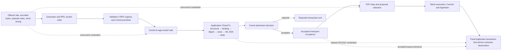

# X01 — mechanism and legitimate-service causal map

Status: reviewed design input for the bounded X extension, 2026-11-14.
Source baseline: PR #28 merge `da46f0cc4f87548825d9768d9242e346c17bb137`,
[D-045](../DECISIONS.md), accepted [RQ1](RESEARCH_PROTOCOL.md) and separate
[RQ1b](FILE02_RQ1B_ADDENDUM.md). The graph is a set of testable pathways,
not a claim that any path caused degradation. All observed Q/A services
remain negative at the original 3-second endpoint.

The dotted arrows are hypotheses to test, not estimated effects. A rejected
transaction may consume ingress, socket and CheckTx work without entering
the accepted mempool or ordinary gossip path. The fixed legitimate H stream
uses the same physical host and competes for CPU, memory, Go scheduling and
disk with four Comet processes, four app handlers in the historical
integration process, the generator and observers. A10's lower validator-0
relay-send envelope under invalid traffic is consistent with early rejection,
but that byte counter alone does not identify peer propagation latency.

## Variables, measurement sites and causal roles

| Node | Intervention or observation | Current coverage and limit |
|---|---|---|
| Workload `W` | Planned and achieved tx/s, encoded B/s, invalid class, distinct/replay status, offsets; L/B/I arm assignment in future X10. | Existing A pairs match benign/invalid offered tx/s and B/s within each case. L arm does not exist yet. Sender scheduling and bytes may vary across profile. |
| Generator `G` | Monotonic socket-write timestamp, offered fidelity, generator CPU/drops. | Socket write marks offered traffic, not Comet acceptance. The generator shares the host. |
| Ingress `I` | RPC validator-0 request/precheck; eventual direct P2P ingress is a separate source. | RPC origin only is supported. Do not infer P2P-origin exposure or per-peer ingress. |
| Socket `S` | Time waiting at the Comet-to-app CheckTx socket. | Existing metric is **only this wait interval**, not a full transaction queue. |
| CheckTx `C` | Stage wall spans and application service time, with rejection stage oracle. | Wall spans are not CPU; process CPU historically shares the integration harness. Crypto CPU is `null` until X06 validation. |
| Admission `A` | Accepted/rejected decision and stage/code. | A01/A04/A05/A08 invalid classes reject before accepted mempool/commit; rejected does not imply zero pre-admission cost. |
| Mempool `M` | Accepted count/bytes and full counters. | Sampled accepted occupancy misses transient queue peaks and rejected work. |
| Relay/proposal `P` | Comet envelope bytes, candidate relay and proposal/commit path. | Bytes are not per-peer propagation latency; no P2P-origin injector is accepted. |
| Commit `B` | Valid exact-once and invalid absence, same-height BlockID/AppHash/state. | Q07 full genesis replay validates committed state in its tested runs. Header AppHash at height H reflects state H−1. |
| Service `L` | Original fixed-legitimate fraction observed on all four by 3,000 ms; future continuous observation upper bound. | 100-ms block scanner and monotonic write yield an **upper bound on first observation**, not exact commit time/finality. Existing binary endpoint is ceiling-limited. |

## Randomization, confounders and identification

The prospective unit of assignment and inference is a **fresh network/run
block**, never a transaction or a 100-ms observation window. Match each
fixture's genesis, fixed legitimate identities/hashes/offsets, topology,
software and target rate before assigning L/B/I or invalid class. Balance
arm order and retain every abort/exclusion. Background class changes both
CheckTx work and downstream accepted work; a B→I contrast therefore
estimates the **total replacement effect**, not pure cryptographic cost.
L→I estimates the effect of adding background to the fixed legitimate
stream, with a different offered total rate; it must not be interpreted as
the B→I replacement effect. Conditioning on accepted transactions alone
would select on admission (which the workload changes) and can bias a total
service-effect estimate. Analyze original assigned arms with preregistered
QC, then use stage/admission metrics for mechanism diagnosis.

Potential confounders or effect modifiers: randomized run order, fixture
seed and account state, transaction wire size, Comet mempool/recheck/cache
state, consensus height/timing and block interval, host CPU frequency and
thermal state, cgroup/VM contention, disk I/O, GC and goroutine scheduling,
observer placement and drops, generator saturation, shared-host clock and
process placement. The single-host architecture introduces correlated
resource contention across validators and common failure modes; four
validators are **not four independent physical replicates**. The original
Q02 `schedule.v1` arm-order flaw is concrete evidence that order matters;
only its balanced v2 session supports current cross-profile inference.

## Testable mechanism predictions and null outcomes

1. Early structural rejection may lower CheckTx wall time and relay bytes
   relative to late ML/state rejection or valid background at matched
   offered bytes/rate; CPU attribution requires X05/X06, not this DAG.
2. A valid benign background can consume more accepted mempool, relay and
   commit work than an invalid background even when the latter costs more
   per CheckTx. B→I may therefore show an opposite-signed or null service
   effect; both are valid outcomes.
3. No original 3-second service miss and no knee through 25 tx/s leave
   queue accumulation, smaller continuous-latency effects and bottleneck
   location **unidentified**, not zero. X07/X08 must establish measurement
   before those hypotheses are tested.

No path in this map uses local clocks, queue size or process CPU as a
consensus validity input. The map does not revise the accepted application
transaction rules or authorize direct P2P/multi-host experiments.
